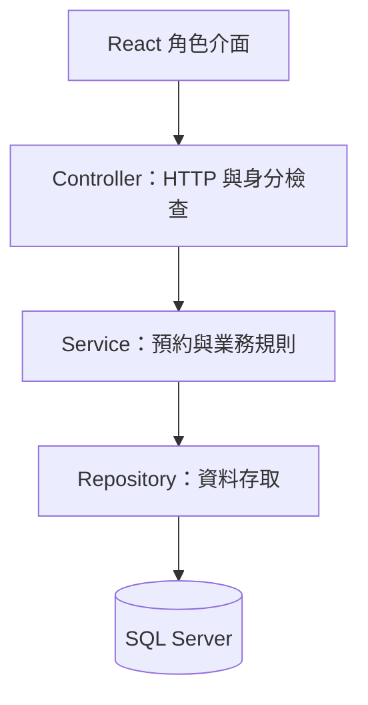

# 力量健身｜Gym CRM 健身房管理系統

**會員預約、教練課表與管理員全館排程，整合在同一套系統。**

本專案是 Java 軟體工程師培訓的團隊專題。本儲存庫由 **吳芳瑜** 整理作為個人作品集，保留團隊程式與提交歷史，並說明我的實作範圍及本機啟動方式。

[個人 GitHub](https://github.com/kikiwu853) · [我的預約功能程式碼](src/main/java/tw/gymproject/service/BookingService.java) · [啟動說明](docs/LOCAL_SETUP.md) · [測試紀錄](docs/PORTFOLIO_VALIDATION.md)

## 我的角色與實作

我由社工領域轉職軟體開發，在專題中負責預約相關功能，並與組員協作完成前後端整合。將會員、教練及管理員的使用需求拆成流程、資料關聯與權限規則，是我在這個專案的主要學習與實作重點。

| 我的實作範圍 | 內容 |
|---|---|
| 會員預約 | 已購課程選擇、可預約日期與時段、建立預約 |
| 我的預約 | 預約紀錄查詢、改期、取消與歷史紀錄呈現 |
| 教練課表 | Dashboard、日期切換、學員預約查詢、改期及取消 |
| 管理員全館課表 | 按日期查看教練排程與預約狀態 |
| 前後端串接 | React 操作介面、Spring Boot API、DTO 與 SQL Server 資料查詢 |

會員帳號管理、課程與教練管理、出席、InBody、續約及關懷等模組由團隊分工協作完成，不將整套系統宣稱為個人獨立開發。

## 系統功能

| 角色 | 功能 |
|---|---|
| 會員 | 登入、查看課程與教練、預約課程、查看／修改／取消個人預約 |
| 教練 | 查看 Dashboard 與課表、管理預約、查看學員、出席與量測紀錄、續約關懷 |
| 管理員 | 會員與教練管理、課程管理、購課管理、全館課表 |

### 預約流程與規則

會員登入 → 選擇已購課程 → 選擇日期與時段 → 建立預約 → 在「我的預約」管理紀錄。

後端檢查購課紀錄是否屬於登入會員、剩餘堂數是否足夠、課程與綁定教練是否符合，以及時段是否開放或已被預約。建立預約限定明日以後；改期維持原購課方案與教練，重新檢查目標時段。

相關程式：

- [會員預約 Controller](src/main/java/tw/gymproject/controller/BookingController.java)
- [預約業務規則 Service](src/main/java/tw/gymproject/service/BookingService.java)
- [預約查詢 Repository](src/main/java/tw/gymproject/repository/BookingRepository.java)
- [教練課表 Controller](src/main/java/tw/gymproject/controller/BookingCoachController.java)
- [全館課表 Controller](src/main/java/tw/gymproject/controller/AdminScheduleController.java)

## 技術架構

| 層級 | 使用技術 |
|---|---|
| 前端 | React 19、Vite 7、JavaScript、部分 TypeScript、CSS |
| 後端 | Java 21、Spring Boot 3.4.3、Spring MVC |
| 資料存取 | Spring Data JPA／Hibernate、Spring Data JDBC、SQL Server |
| 登入 | HttpSession、BCrypt 密碼雜湊 |
| 開發協作 | Git／GitHub、Maven、npm、Eclipse／STS、SSMS |



主要資料關聯包含 `membercourse`（會員購課與指派教練）、`classschedule`（課表）、`booking`（預約）及 `attendance`（出席）。API 使用 Session 判斷登入者與角色，前端在開發模式透過 Vite proxy 連接後端。

## 實際畫面

以下為本機執行的登入頁；系統目前以本機展示為主，尚未提供公開線上 Demo。


## 本機執行

需求：**JDK 21、Node.js 22.12 以上、SQL Server**，以及 Eclipse／STS 的 Maven 支援或已安裝的 Maven。

```bash
git clone https://github.com/kikiwu853/GymProject.git
cd GymProject
```

1. 準備與程式相容的 SQL Server 資料庫。既有資料庫與全新環境的注意事項見 [本機啟動說明](docs/LOCAL_SETUP.md)。
2. 在後端執行設定提供 `DB_URL`、`DB_USERNAME`、`DB_PASSWORD`，以 JDK 21 啟動 `tw.gymproject.GymApplication`。
3. 開啟另一個終端機啟動前端：

```bash
cd frontend
npm ci
npm run dev
```

瀏覽器開啟 **http://localhost:5173**；後端使用 **http://localhost:8080**。

> `ddl-auto=validate` 只檢查結構，不會替空資料庫建表。團隊原有 SQL 含重建／清空資料的腳本，展示資料也有固定日期限制，請先閱讀啟動文件，不要依檔名順序全部執行。

## 目前驗證範圍

2026-11-17 在 Windows 本機完成後端啟動、SQL Server 連線、Hibernate 結構檢查、前端登入頁，以及會員／教練／管理員登入測試。詳細自動測試結果與尚未驗證的範圍見 [測試紀錄](docs/PORTFOLIO_VALIDATION.md)。

## 團隊來源

- 原始專案：[sallyyu870507-eng/GymProject](https://github.com/sallyyu870507-eng/GymProject)
- 本次作品集整理基準：[`80fbafc`](https://github.com/sallyyu870507-eng/GymProject/commit/80fbafca0e2f5304daff1fa6f38a616768b20c08)
- 經團隊同意，整理為個人求職展示。團隊提交紀錄予以保留。
- 本儲存庫未另行宣告開源授權；公開瀏覽不代表授予任意再散布權利。
